# mini-r2 の印刷と組立の手順書（初心者向け）

最終確認日: 2026-11-18

小型機 **`mini-r2`**（胴体 96 × 62 mm、上腿 40 mm、下腿 44 mm、MG90S × 8、電池なし、総質量 220.1 g の設計値）を、
Bambu Lab A1 mini で印刷して組み立てるための手順書です。

- **実機はまだ製作していません。** 手順は CAD（`robot/meshes/mini-r2/*.stl`）と設計スクリプト
  `robot/design/quadruped8.py`（`leg_rev=2`）から組み立てた案で、実物で確かめたものではありません。
- 図は CAD の部品を MuJoCo で描いた画像です（実物の写真ではありません）。橙色がその手順で足す部品、
  薄い灰色が付け終わった印刷部品、濃い灰色がサーボなどの買う部品です。
- 図と印刷の計画は `uv run python scripts/assembly_guide.py --variant mini-r2` で作り直せます
  （出力は `artifacts/mini-r2/assembly/`。数値は `print_plan.json`）。
- 買う物は [shopping-list.md](shopping-list.md)、部品表と未検証事項の一覧は [manufacturing.md](manufacturing.md)、
  配線の電気的な注意は [esp32-deployment.md](esp32-deployment.md) §8 にあります。

## 0. mini ではなく mini-r2 を使う

前の小型機 `mini` は、STL を調べたところ**脚が組めない設計**でした（膝サーボのタブが閉じた溝に入る、
ホーンの凹みが板の中に閉じている、膝サーボのリード線の出口が無い）。この3点を直したのが `mini-r2`
（設計スクリプトの `leg_rev=2`。ほかの値は mini と同じ）です。**mini の STL は印刷しないでください。**

`artifacts/mini-r2/assembly/print_plan.json` の `assembly_verdict` は7項目すべて true です
（股サーボ・cover・膝サーボ・股ホーン・膝ホーンがどれもまっすぐ入り、当たる光線 0%。股・膝のリード線の閉じた空間はどちらも 5 mm³）。

mini からの変更点:

- 膝サーボは上腿の**内側（胴体の側）から**差し込み、取付タブを外側の板に当てて、内側から M2 タッピングネジで留めます。
  リード線はその差し込み口から胴体の側へ出ます。
- 十字ホーンは、上腿・下腿の**サーボ側の面**に開いた十字の凹みに収まり、ホーンの腕の外側の穴 2か所に、ホーン側からネジを締めます。
- そのぶん上腿は 3.5 mm、下腿と足先は合わせて 7 mm 外へ移りました。足先の左右の位置は ±49.8 mm（mini は ±42.8 mm）。
- **学習済みの方策は mini-r2 用に学び直しました**（シミュレーションだけ。[experiment-results.md](experiment-results.md) §9・§11）。
  ただし実機では確かめていないので、組み立てたらまず、サーボを1個ずつ動かす確認と較正をします（[servo-calibration.md](servo-calibration.md)）。

## 1. 用意する物

| 物 | 数 | 補足 |
|---|---|---|
| Bambu Lab A1 mini と付属のプレート | 1 | 造形範囲 180 × 180 × 180 mm、0.4 mm ノズル |
| PLA フィラメント | 約98 g（推定） | 1 kg のリールで足りる |
| MG90S サーボ | 8（予備 2） | 届いたら1個ずつ動くか確かめる（[shopping-list.md](shopping-list.md) §3） |
| ESP32-S3 開発ボード | 1 | 手元の物。型番・寸法は未確認 |
| 5V の電源 | 1 | スマホの充電器か、AC アダプタ 5V 4A と DC ジャック |
| ブレッドボードとジャンパー線 | 1〜2枚、20本ほど | オス–オスの線 |
| M2×10 六角穴付きボルト | 2 | 胴体の上下を留める |
| M2×6 タッピングネジ | 24 | ホーンを脚に留める 16本（1関節に2本 × 8）＋ 膝サーボのタブを留める 8本（1個に2本 × 4）。[shopping-list.md](shopping-list.md) の 16本は mini の数え方で、400本セットなら足りる |
| 精密ドライバー（＋の小さいもの） | 1 | 軸の太さ 3.5 mm 以下（脚の穴から差し込むため。§4.5） |
| 六角レンチ 1.5 mm | 1 | M2×10 用 |
| ニッパー | 1 | サポート材を取る |
| 滑り止めシート | 少し | 足先に貼る |
| 瞬間接着剤 | 少し | 足先を下腿に付けるのに要りそう（未購入。§4.8） |
| マスキングテープと油性ペン | 少し | 部品に名前を書く（左右の取り違えを防ぐ） |

## 2. 印刷する部品

### 2.1 部品の一覧

STL は `robot/meshes/mini-r2/<名前>.stl` にあります。STL は Git に入れていないので、無ければ次で作ります（mini の値に `leg_rev=2` を足したもの）。

```bash
uv run python scripts/build_robot.py --variant mini-r2 --set body_length=96 --set body_width=62 \
  --set battery_mass_g=0 --set hip_x=40 --set thigh_length=40 --set shin_length=44 --set leg_rev=2
```

`robot/meshes/mini-r2/` にはサーボ・ホーン・ボルト・ESP32 の代わりの形の STL も出ますが、**印刷するのは下の14個だけ**です。

| 部品 | STL | 個数 | 大きさ（mm、置いた向きで 幅 × 奥行き × 高さ） | ベッドに置く面 | サポート | 下向きの面（mm²） | フィラメント（推定） |
|---|---|---|---|---|---|---|---|
| 胴体の下半分 | `chassis.stl` | 1 | 96 × 62 × 8.6 | 底面（いちばん広い平らな面） | 不要 | 0 | 13.1 g |
| 胴体の上半分 | `cover.stl` | 1 | 96 × 62 × 15.4 | 上面（ESP32 を載せる浅い凹みがある面） | 不要 | 684（すべて橋渡し） | 30.2 g |
| 上腿 | `thigh_lf.stl`、`thigh_rf.stl`、`thigh_lh.stl`、`thigh_rh.stl` | 各1 | 71.0 × 51.2 × 30.9 | 外側の平らな板の面（膝サーボの箱と差し込み口が上を向く） | 不要 | 0 | 9.3 g × 4 |
| 下腿 | `shin_lf.stl`、`shin_rf.stl`、`shin_lh.stl`、`shin_rh.stl` | 各1 | 53.4 × 36.7 × 6.5 | 外側の板の面（十字の凹みが上を向く） | 不要 | 0 | 3.6 g × 4 |
| 足先 | `foot_lf.stl`、`foot_rf.stl`、`foot_lh.stl`、`foot_rh.stl` | 各1 | 直径 12 の球 | どの向きでも同じ | **必要** | 66 | 0.7 g × 4 |
| **合計** | | **14** | | | | | **約98 g** |

- **言葉**: 「張り出し（オーバーハング）」は、下に何も無いまま宙に浮いて印刷される部分です。
  「橋渡し（ブリッジ）」は、両端が支えられた水平な張り出しで、短ければサポート（印刷後に取り除く支え）無しで刷れます。
- **向きの決め方**: 部品ごとに6通りの置き方を試し、鉛直から 45° より寝た下向きの面（ベッドに接する面を除く）の面積が
  最も小さい向きを選びました（`print_plan.json` の `orientations`）。上腿・下腿は張り出しが 0、`cover` は水平な橋渡しだけになる向きです。
  これは STL から計算した目安で、**スライサー（Bambu Studio）のプレビューが最終判断**です。
- **フィラメント**: 体積 × 実効密度 0.8 g/cm³（PLA、充填率約30%、外周4本の想定）で推定しました。
  サポート・ブリム・ノズルの掃除に使う分は入っていません。設計レポート（`artifacts/mini-r2/design_report.json`）の PLA 94.9 g に、PLA の足先 2.9 g を足した量と合います
  （設計レポートは足先を TPU として数えています）。
- **印刷時間**: 分かりません。Bambu Studio でスライスすると画面に出るので、そこで確認してください。
- **左右**: 上腿と下腿は、左（`lf`、`lh`）と右（`rf`、`rh`）が鏡像（左右反転）の形です。前と後ろは同じ形です。
  印刷したらすぐ、内側の面にマスキングテープを貼り、名前（`lf` など）を書いておくと取り違えません。

### 2.2 プレートの割り振り

1枚のプレートに全部は載らないので、4枚に分けます（種類ごとに分けると、失敗したときの損が小さい）。
並べ方は、外形を 5 mm の余白で 180 × 180 mm に詰めて確かめた一例です。Bambu Studio の「自動配置」（A キー）で並べ直して構いません。

| プレート | 載せる物 | フィラメント（推定） | 図 |
|---|---|---|---|
| 1 | `chassis`、`cover` | 43.3 g | 下 |
| 2 | 上腿 4本 | 37.2 g | 下 |
| 3 | 下腿 4本 | 14.4 g | 下 |
| 4 | 足先 4個（サポートあり） | 2.9 g | 下 |

プレート1（`cover` は上面を下にしている）:

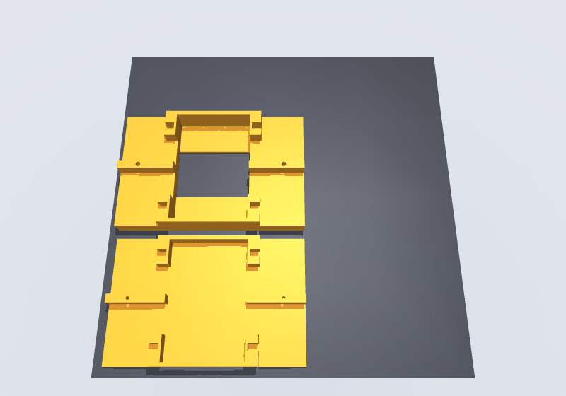

プレート2（上腿。外側の板を下にし、膝サーボの箱が上を向く）:

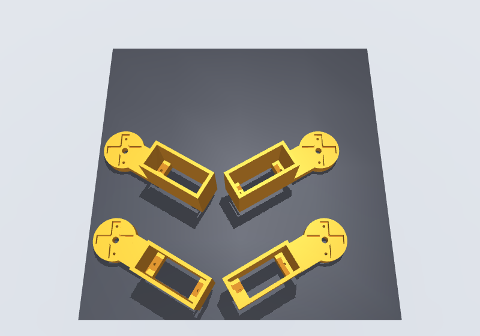

プレート3（下腿。外側の板を下にする）:

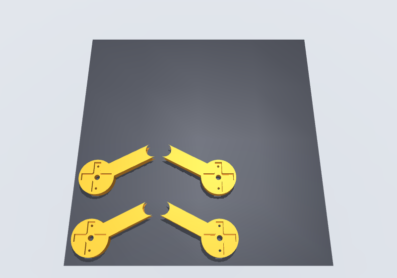

プレート4（足先。サポートを有効にする）:

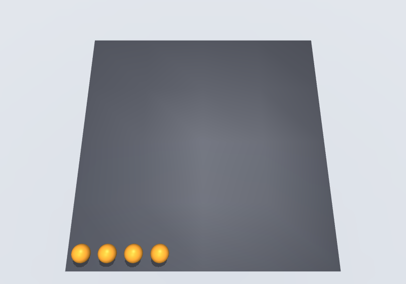

全部を刷る前に、§3.2 の試し印刷で入り具合を確かめてください。

## 3. A1 mini と Bambu Studio の設定

### 3.1 設定

1. Bambu Studio を開き、プリンタに「Bambu Lab A1 mini（0.4 mm ノズル）」を選ぶ。
2. フィラメントは、Bambu 純正なら「Bambu PLA Basic」、ほかの PLA（SUNLU PLA+ など）なら「Generic PLA」を選ぶ。
   **温度は既定のまま**にします（変えない）。
3. 「プロセス」は既定の「0.20mm Standard @BBL A1M」を選び、下の表の2か所だけ変える。
4. STL を読み込み、§2.1 の「ベッドに置く面」を下にする。ツールバーの「面を選択して配置」（Lay on face、F キー）で、その面をクリックすると置ける。
5. 「スライス」を押し、プレビューで層を1枚ずつ動かして、宙に浮いた線が無いか、橋渡しが短いかを見る。

| 項目 | 値 | 既定から変えるか |
|---|---|---|
| 層の高さ（1層の厚さ） | 0.2 mm | そのまま |
| 壁のループ数（外周の本数） | **4** | 変える（既定は 2）。質量の推定と強度の前提 |
| スパース充填密度（中を埋める割合） | **30%** | 変える（既定は 15%） |
| 充填パターン、上下の層の数 | 既定 | そのまま |
| サポート | プレート1〜3 は**無効**。プレート4（足先）は**有効**、タイプは「tree(auto)」 | プレート4 だけ変える |
| ブリム（縁に付ける薄い膜。はがれ防止） | 既定（自動） | そのまま |
| ノズル・ベッドの温度、速度 | 既定 | そのまま |

- プレートは指で触らない（指の油で部品がはがれやすくなる）。汚れたら台所用洗剤で洗う。
- 足先の球は、ベッドに点でしか接しないのでサポートが要ります。球の表面にサポートの跡が残るので、ニッパーとやすりで整えます。

### 3.2 試し印刷を勧める部品

張り出しとサーボの入り具合は、実物で確かめていません（[manufacturing.md](manufacturing.md) の未検証事項）。全部を刷る前に、次の順で確かめます。

| 順 | 部品 | 確かめること | 合わないとき |
|---|---|---|---|
| 1 | `chassis`（13 g） | MG90S が4つの収納部に入るか（すきまは片側 0.5 mm の設計）。前後の端の取付タブが当たらないか。M2×10 の下穴にねじが入るか | きつい・緩いときは設計の `clearance` を変えて STL を作り直す（設計の担当に伝える） |
| 2 | `cover`（30 g） | 上面を下にしたとき、ESP32 の浅い凹みの底（約 26 mm の橋渡し）が垂れずに刷れるか。手元の ESP32 が凹みに収まるか（凹みは 63 × 25.5 mm のボードを想定） | 垂れが大きければ、その部分だけサポートを付ける（Bambu Studio の「サポートを描く」） |
| 3 | 足先 1個（0.7 g） | サポートがきれいに取れるか、球の形が残るか | サポートのタイプや接触面の設定を変える |
| 4 | 下腿 1本（3.6 g）→ 上腿 1本（9.3 g） | 十字ホーンが凹みにはまるか、ホーンの腕の穴から M2×6 が下穴に入るか。膝サーボが内側から入り、タブが外側の板に当たるか（外面からの浮きは最大 0.5 mm の設計）。タブの穴から M2×6 が留まるか。リード線が差し込み口から出せるか | 設計の担当に伝える |

`chassis` の1か所だけを試したいときは、Bambu Studio の「カット」ツールで部品の端だけを切り出して刷る方法もあります（時間とフィラメントの節約）。

## 4. 組み立て

### 4.1 サーボの中立出し（図なし）

この段は CAD で描けないので図はありません。

**中立**とは、サーボが動ける範囲（約180°）のちょうど真ん中の位置です。ホーン（と脚）は、サーボを中立にした状態で、
脚が**立った姿勢**になる向きに取り付けます。理由:

- 関節が動く範囲は、たとえば前脚の股で -45°〜+20°、膝で -60°〜+45° です（[hardware-spec.md](hardware-spec.md)）。
  サーボがでたらめな位置のままホーンを付けると、脚を動かす途中でサーボが端に当たって止まり、歩けません。
- ファームウェアは「中立のパルス（1450 µs、推定値）＝関節角 0＝立った姿勢」として角度を計算します
  （`deploy/esp32/export_c.py` の `ServoConfig`）。

**中立にする方法**: 次のどちらかにします。

1. **ESP32 の試験・較正プログラムで中立を出す**（勧める方法）。サーボを1個ずつ ESP32 につないで中立にし、その場でホーンを付けます。
   手順は [servo-calibration.md](servo-calibration.md) §5・§6 にあります（ESP-IDF でのビルドと実機での動作は、まだ確かめていません）。
   §4.2・§4.3 の胴体の組立は、ホーン無しで先に進められます。
2. **サーボテスター**（サーボに決まったパルスを出す小さな道具。「中央」のモードがある）を使う。買い物の一覧には入っていません（価格は調べていません）。
   多くのテスターの中央は 1500 µs で、ファームウェアの 1450 µs と約 5° 違います。この差は後で較正します（下）。

**やってはいけないこと**:

- **ホーンや出力軸を手で回して真ん中を探さない。** 中のギアに無理な力がかかり、欠けたり、位置を読む部品がずれたりします。
  安い互換品はギアの一部が樹脂のことがあります。特に**電源が入っているときに手で回すのは厳禁**です（サーボが逆らって力を出す）。
- 中立にしたあと、ホーンを付けるまでの間に軸を回さない。

**ホーンの向きの合わせ方**: スプラインの歯は 21 枚（カタログ値）なので、ホーンは約 17° 刻みでしか差し替えられません。
立った姿勢に最も近い歯で差し込み、残りのずれ（最大で約 ±9°）は、ファームウェアの関節ごとの補正 `trim_deg` で吸収します
（較正のやり方は [esp32-deployment.md](esp32-deployment.md) §8）。

立った姿勢の目安（左から見た図。**図の左が前**）: 上腿は股から**後ろ下へ 30°** 傾き、下腿は膝から前下へ伸びて、
**足先が股の軸の真下**に来ます。

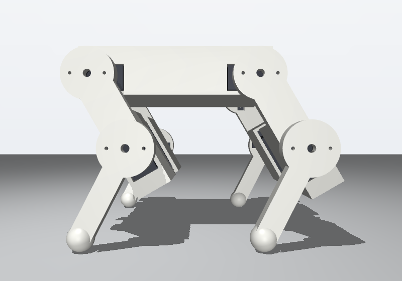

### 4.2 股サーボ 4個を `chassis` に入れる

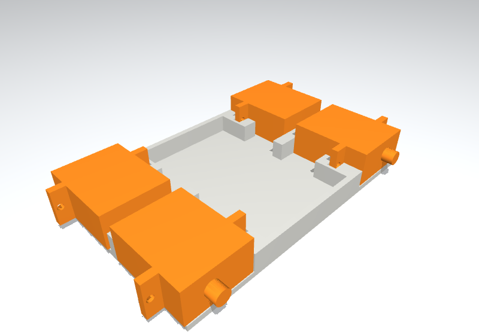

1. `chassis` を平らな面を下にして置く（図は左前の斜め上から見たもの）。
2. 股サーボを4つの収納部に上から入れる。**出力軸（ホーンを付ける軸）は外向き**（胴体の左右の側面から外へ出る向き）。
3. 出力軸がケースの端に寄っている側が、**胴体の前後の端**に来る向きにする（前の2個は前寄り、後ろの2個は後ろ寄り）。
   リード線は胴体の中央の空洞の側に来ます。図のとおり、前後の端では取付タブとケースの先が胴体から少しはみ出します（前の股サーボで約 5.6 mm。設計どおり）。
4. リード線を、収納部の奥の逃げから中央の空洞へ通す。線を収納部の縁に載せたままにしない（次の手順で挟む）。

STL の判定では、股サーボは上からまっすぐ入ります（`fit_checks` で当たる光線 0%）。すきま 0.5 mm で実物が入るかは未確認です（§3.2）。

### 4.3 `cover` を被せて M2×10 を2本締める

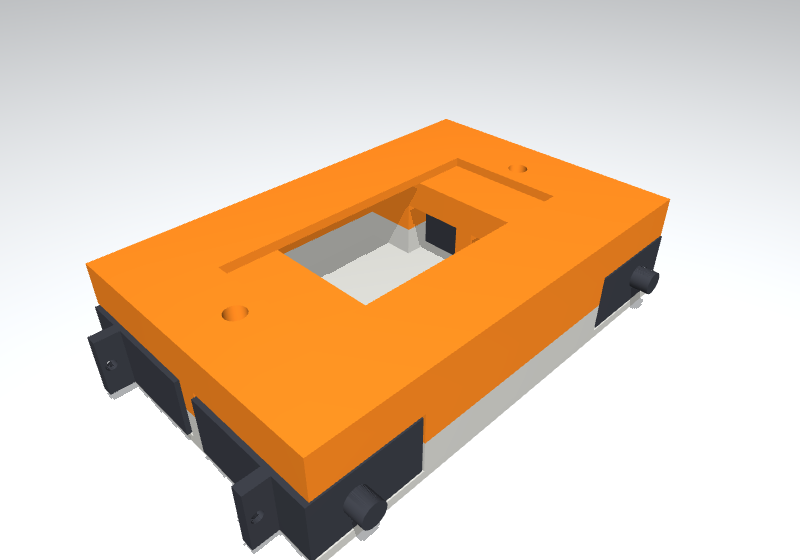

1. 股サーボの4本のリード線を中央の空洞にまとめ、`cover` の中央の窓（ESP32 の凹みの下に開いた約 39 × 26.5 mm の穴）から上へ出す。
2. `cover` を上から被せる。サーボの取付タブ（内側の端）が `chassis` と `cover` に上下から挟まれます。
   **リード線を挟んでいないか**、すき間から見て確かめる。浮いていたら無理に押さず、いったん外して線を直す。
3. M2×10 を2本、`cover` の上面の丸い座ぐり（ボルトの頭が沈む段付きの穴）から入れ、`chassis` の下穴にねじ込む。
   下穴にはねじ山が無く、ボルトが自分でねじ山を切りながら入ります。**ゆっくり回し、軽く止まったらそれ以上締めない**（§6）。

`cover` は上からまっすぐ被せられます（`fit_checks` 0%）。股サーボのリード線は胴体の空洞から窓へ抜けます（`enclosed_voids` は 5 mm³ で、残るのは小さな隅だけ）。

### 4.4 膝サーボを上腿に入れ、タブをネジで留める

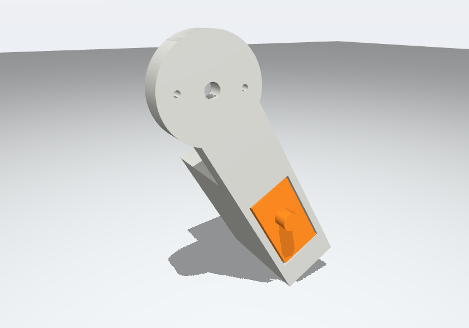

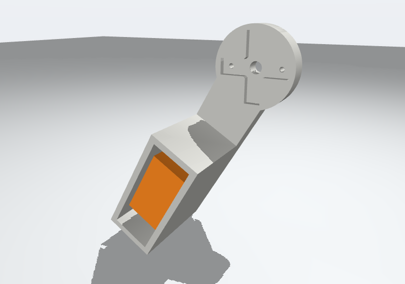

上の図は左前脚 `thigh_lf` を外側から、下の図は内側（胴体の側）から見たものです。内側の図で、四角い箱の開いた口が膝サーボの差し込み口、
上の丸い部分の十字の溝が股ホーンの凹み（§4.5）です。膝サーボはこの段で入れます（上腿を胴体に付けたあとだと、差し込み口が胴体の側を向いて手が入りにくい）。

1. 膝サーボを、**出力軸が上腿の外側の面から出る向き**で持つ。軸は膝の側（上腿の下の端、丸い部分）に来て、ケースは膝から足先の側へ伸びます。
2. 上腿の**内側の差し込み口から**、外側へ向けてまっすぐ押し込む（`fit_checks` で当たる光線 0%）。
   取付タブ（ケースの両端の薄い耳）が外側の板の内面に当たったところで止まります。
3. 外側から見て、出力軸が外側の面の穴から出ていることを確かめる。
4. タブの2つの穴から、**内側から** M2×6 タッピングネジを1本ずつ、外側の板の下穴（深さ 5 mm）へねじ込む。軽く止まったら止める（§6）。
5. リード線は、ケースの後ろ（足先の側）の逃げから、差し込み口を通って**胴体の側へ**出す。上腿の箱の縁で線を挟まないようにする。

4本の上腿に同じように入れます。右の脚（`rf`、`rh`）は鏡像で、差し込み口は同じく胴体の側にあります。

### 4.5 股ホーンを上腿に留め、股サーボの軸に差す

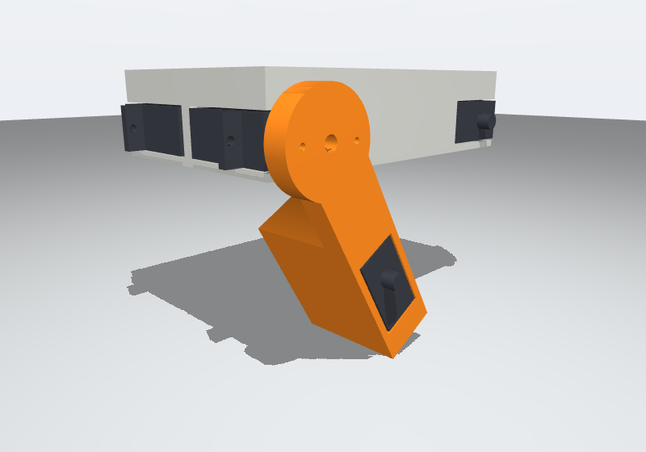

1. 股サーボが中立になっていることを確かめる（§4.1）。
2. 十字ホーンを、上腿の**内側の面（サーボ側）の十字の凹み**にはめる。ハブ（中心の筒）はサーボ側へ向けます。
3. ホーンの腕の**いちばん外側の穴**（中心から 8 mm）2か所に、**ホーン側から** M2×6 タッピングネジを入れ、上腿の下穴へねじ込む（対角の2本）。
4. 上腿を、§4.1 の立った姿勢（後ろ下へ 30°）の向きで、股サーボの軸に押し込む。ちょうど合わなければ、近い歯で差し直す（回して合わせない）。
5. サーボ付属のホーン固定ネジ（ホーンの中心のネジ）を、上腿の外側の小さな穴（直径 約3.8 mm）からドライバーを入れて締める。
   このネジの頭が凹みの底に当たらないかは未確認です（§7）。

### 4.6 4本の上腿を付けた状態

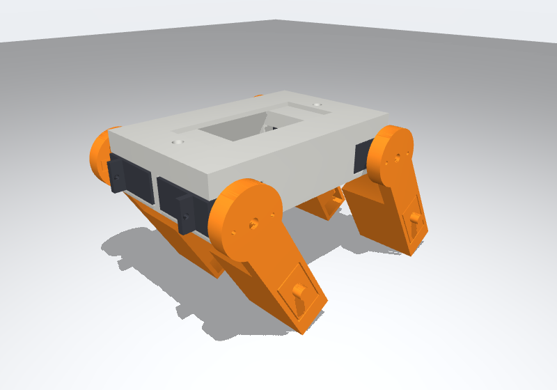

- 左の脚には `thigh_lf`・`thigh_lh`、右の脚には `thigh_rf`・`thigh_rh` を付ける（左右は鏡像なので、逆には正しく付かない）。
- 4本とも同じ姿勢（後ろ下へ 30°）になっているか、横から見て揃っているかを確かめる。
- 膝サーボのリード線が、上腿と胴体の間で挟まれていないかを見る。

### 4.7 膝ホーンと下腿を付ける

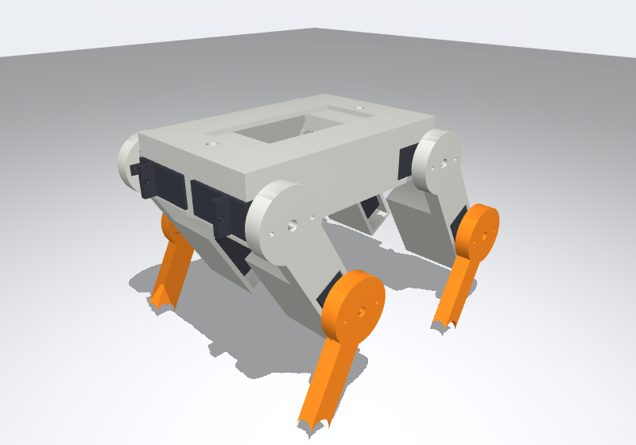

手順は §4.5 と同じです。

1. 膝サーボを中立にする（§4.1）。
2. 十字ホーンを、下腿の**内側の面（膝サーボの側）の十字の凹み**にはめ、腕のいちばん外側の穴 2か所に、ホーン側から M2×6 タッピングネジで留める。
3. 下腿を、**前下へ伸びて足先が股の真下に来る**向きで、上腿の外側に出ている膝サーボの軸に押し込む。
4. 中心のネジを、下腿の外側の穴からドライバーを入れて締める。

### 4.8 足先を付け、滑り止めシートを貼る

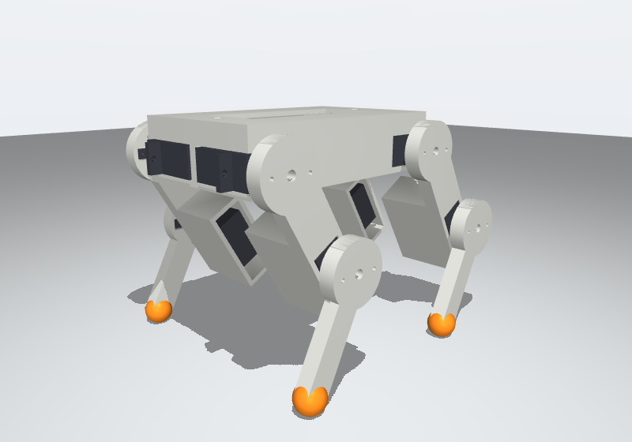

下腿の先は、足先の球がはまる丸いくぼみになっています。付け方は設計にまだありません（未設計）。案:

1. 足先の球のサポートの跡を、やすりで整える。
2. くぼみに瞬間接着剤を少し付け、球を押し当てて固める（接着の強さは未検証）。
3. 滑り止めシートを小さく（直径 8 mm ほどの丸に）切り、球の**いちばん下**（床に当たる所）に貼る。
   シートは平らなので、球面にはしわが寄ります。貼り方と、平らな面が要るかは未検証です。

### 4.9 ESP32-S3 の置き場所

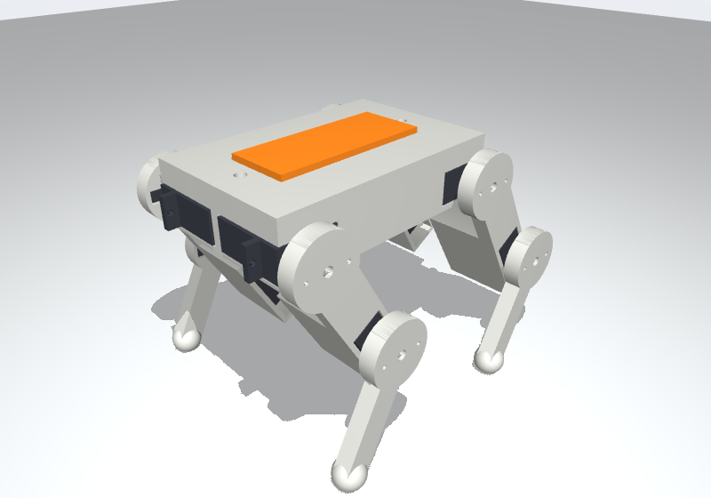

設計では、ESP32-S3 は `cover` の上面の浅い凹み（深さ 2 mm）に載ります。ただし、

- 凹みは 63 × 25.5 mm のボード（DevKitC-1）を想定していて、手元のボードが収まるかは未確認です。
- ボードの裏のピン（ピンヘッダの足）が凹みの底に当たる可能性があります（窓の上にあるピンは空洞へ落ちるが、両端のピンは当たる）。

**最初はロボットに載せず、ESP32 はブレッドボードに挿したまま机に置き、サーボとは線でつなぎます**（§5）。
電源コードもつながったままなので、このほうが簡単です。

### 4.10 配線の通し方（図なし）

CAD にはリード線が無いので、この段の図はありません。

- **股サーボ（4本）**: 収納部の奥 → 胴体の中央の空洞 → `cover` の窓から上へ出す（§4.2、§4.3）。
- **膝サーボ（4本）**: 上腿の内側の差し込み口（§4.4）→ 上腿の内側の面に沿わせて股の側へ → 胴体の横を通って上へ出す
  （股サーボの線と違い、胴体の中は通りません。線の留め方は未設計）。膝と股は回るので、**関節のそばでは線にたるみを残し**、下腿や上腿の回る範囲に線が入らないようにします。
- 8本の線をまとめて、胴体の上からブレッドボードへ渡す。MG90S のリード線の長さ（一般に 25 cm 前後。未確認）で届かなければ、
  オス–メスのジャンパー線で延ばす。
- 電源コードとリード線の重さや引っ張りがロボットに掛からないよう、ロボットの近くで机に軽く留める（留め方は未設計）。

## 5. 配線

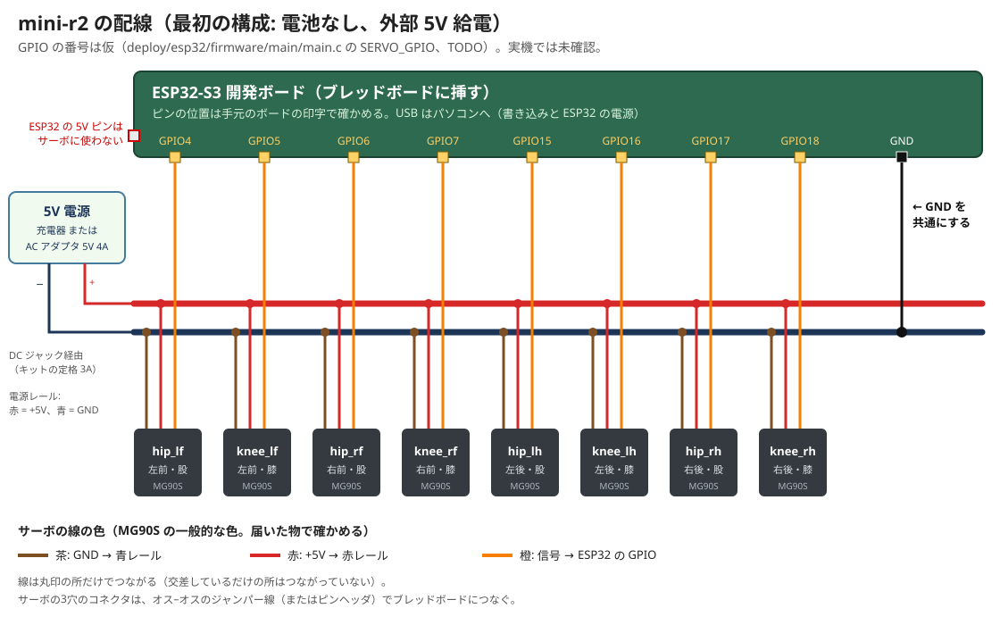

| サーボ（関節） | 場所 | 信号線をつなぐ GPIO（**仮**） |
|---|---|---|
| `hip_lf` | 左前・股 | GPIO 4 |
| `knee_lf` | 左前・膝 | GPIO 5 |
| `hip_rf` | 右前・股 | GPIO 6 |
| `knee_rf` | 右前・膝 | GPIO 7 |
| `hip_lh` | 左後・股 | GPIO 15 |
| `knee_lh` | 左後・膝 | GPIO 16 |
| `hip_rh` | 右後・股 | GPIO 17 |
| `knee_rh` | 右後・膝 | GPIO 18 |

- GPIO の番号は `deploy/esp32/firmware/main/main.c` の `SERVO_GPIO = {4, 5, 6, 7, 15, 16, 17, 18}`（コメントに TODO とある**仮の値**）です。
  並び（関節の順）は、学習タスク `robot/mjcf/mini-r2/walk-task.json` の `actions` の順（`hip_lf, knee_lf, hip_rf, knee_rf, hip_lh, knee_lh, hip_rh, knee_rh`）に合わせました。
- Espressif の資料の一般論では、ESP32-S3 の GPIO 0・3・45・46 は起動時の設定に、19・20 は USB に使われ、上の8本はそれを避けています。
  手元のボードでこのピンが外に出ているか、別の用途に取られていないかは、型番が分かってから確かめてください（未確認）。

つなぎ方:

1. **電源を抜いた状態で**配線する。
2. 5V 電源の + をブレッドボードの赤い電源レールへ、− を青い電源レールへつなぐ。
3. 各サーボの3本の線をつなぐ。色は MG90S で一般的な **茶 = GND、赤 = +5V、橙 = 信号**（届いた物で確かめる）。
   - 茶 → 青レール（GND）
   - 赤 → 赤レール（+5V）
   - 橙 → 上の表の GPIO
4. **ESP32 の GND ピンと青レール（GND）をジャンパー線でつなぐ**（GND を共通にする。つながないとサーボが信号を正しく受け取れない）。
5. **ESP32 の 5V ピンにはサーボの赤い線をつながない。** サーボの電源は 5V 電源から直接取ります。
6. ESP32 は USB でパソコンにつなぐ（書き込みと ESP32 の電源）。外部の 5V から ESP32 にも給電する方法は、ボードの回路図で確かめるまでやらない（未確認）。

## 6. よくある失敗と注意

| 失敗 | 起きること | 防ぎ方 |
|---|---|---|
| ネジの締めすぎ | PLA に切ったねじ山が崩れ、空回りして留まらなくなる | 軽く止まったら止める。何度も締め直さない。崩れたら、少し太い・長いネジに替えるか、穴を接着剤で埋めて開け直す |
| M2 のネジがホーンの穴に通らない | ホーンの腕の穴は小さい（カタログで直径 1.0 mm） | M2×6 が通らなければ、サーボ付属の小ネジを使うか、ホーンの穴を広げる（どちらも未検証） |
| サーボの向きの間違い | 股サーボの出力軸が内向き、前後が逆、など | §4.2 の図のとおり、軸は外向き、軸の寄った側が胴体の前後の端 |
| 左右の上腿・下腿の取り違え | 脚が正しく付かない | 印刷直後に名前を書く（§2.1） |
| 左右のサーボの回る向き | 同じ指令で、左の脚と右の脚が逆に振れる（左右でサーボが向き合っているため） | 異常ではない。ファームウェアの関節ごとの `sign`（+1 か -1）で合わせる（[esp32-deployment.md](esp32-deployment.md) §8。名目の既定は左 +1・右 -1。実物で [servo-calibration.md](servo-calibration.md) §7.3 の `flip` で確かめる） |
| ケーブルの挟み込み | `cover` と `chassis` の間、関節の回る所で線が切れる・ショートする | `cover` を閉じる前に線の位置を見る。関節のそばはたるみを残す |
| ホーンを手で回す | ギアが欠ける、位置がずれる | 中立はパルスで出す（§4.1）。通電中は絶対に回さない |
| 9V・12V の充電器 | サーボが壊れる | USB-PD の充電器は 9V などを出すことがある。**5V だけ**を使う |
| 電源不足 | サーボが震える、ESP32 が再起動する | 充電器の出力（5V で何 A か）を見る。3A 未満なら AC アダプタ 5V 4A を使う（[shopping-list.md](shopping-list.md) §3） |
| サーボが端に当たり続ける | 「ジー」と鳴って熱くなる、壊れる | すぐ電源を抜く。ホーンの向き（中立）を見直す |

**電源を入れる前の確認**（毎回）:

1. 5V 電源の出力が 5V か（充電器の表示）。
2. 赤レールに赤い線（+）、青レールに茶色の線（−）だけがつながっているか。+ と − が直接触れていないか。
3. ESP32 の GND と青レールがつながっているか。ESP32 の 5V ピンにサーボの線がつながっていないか。
4. 信号線（橙）が上の表の GPIO に挿さっているか。
5. ロボットを箱などに載せ、**脚が床や手に当たらない**状態にしたか。
6. すぐ電源を抜ける位置に手があるか。
7. 最初は**サーボを1個だけ**つないで動かし、問題なければ1個ずつ増やす。

## 7. まだ分からないこと（未検証）

| 項目 | 状態 |
|---|---|
| 膝サーボの浮き | タブを外側の板に当てたとき、ケースの上面（軸の出る面）が上腿の外面から最大 0.5 mm 浮く設計（タブ側のすきま）。下腿との間の距離が設計からずれるかは未確認 |
| ホーンの中心ネジの頭と凹みの干渉 | 中心ネジの頭が、ホーンの凹みの底や上腿・下腿の穴（直径 約3.8 mm）に当たらないかは未確認（STL の判定はホーンだけを見ている） |
| 実物のホーンの寸法と、スプラインへのかぶさり方 | CAD はスプラインの先端に載る簡略形（SG90 付属品の実測値の流用）。実物はスプラインにかぶさるので、最大でスプラインの高さ（4 mm、推定）だけサーボ側に寄る。凹みの形は変わらないが、上腿・下腿もいっしょに寄る。MG90S 付属品は未計測 |
| ホーンの腕の穴に M2×6 が通るか、タッピングネジの保持力 | 未検証（カタログの穴径 1.0 mm）。膝サーボのタブのネジ（下穴 5 mm）の保持力も未検証 |
| サーボ収納部のすきま 0.5 mm | 試し印刷で確かめる（§3.2） |
| 張り出しとサポートの要否 | STL から下向きの面を計算した（§2.1）。スライサーと実物の印刷では未確認 |
| `cover` の ESP32 の凹みの底の橋渡し（約 26 mm） | 垂れるかは未確認 |
| 1枚のプレートに載るか | 外形の矩形で計算した（§2.2）。スライサーでは並べていない |
| 印刷時間 | 未確認（Bambu Studio でスライスして確認） |
| 膝サーボのリード線の胴体までの通し方、ESP32・IMU の固定、足先の付け方、滑り止めシートの貼り方 | 未設計 |
| 学習済みの方策 | mini-r2-p7-eff をシミュレーションで学習済み（[experiment-results.md](experiment-results.md) §9）。実機では未確認 |
| 手元の ESP32-S3 の型番・寸法・ピン配置、凹みに収まるか、ピンの足が当たるか | 未確認 |
| GPIO の割り当て | 仮（`main.c` の TODO）。手元のボードで使えるかは未確認 |
| 3.3V の信号で 5V 給電の MG90S を動かせるか | 未確認 |
| 中立のパルス幅（1450 µs）と、500〜2400 µs で約180° という値 | 推定値。個体ごとに較正する |
| 中立を出す試験・較正プログラム | ある（[servo-calibration.md](servo-calibration.md)）。ホストのテストだけで、ESP-IDF でのビルドと実機での動作は未確認 |
| サーボ8個が同時に使う電流、充電器で足りるか | 未計測 |
| PLA の足先＋滑り止めシートの摩擦 | 未確認（シミュレーションは摩擦係数 0.9 の推定値） |
| MG90S のリード線の長さ、線の色 | 一般的な値（長さ 25 cm 前後、茶・赤・橙）。届いた物で確かめる |
| 電源コードの重さと引っ張りの影響、留め方 | 未設計・未確認 |

## 8. 図と計画の作り直し

```bash
uv run python scripts/assembly_guide.py --variant mini-r2            # 図（PNG）と print_plan.json
uv run python scripts/assembly_guide.py --variant mini-r2 --no-images # print_plan.json だけ
```

- 出力: `artifacts/mini-r2/assembly/`（`plate*.png` 4枚、`step*.png` 9枚、`stand_side.png`、`print_plan.json`）。
  配線図 `wiring.svg` は手で描いた図（mini と同じ配線）で、このスクリプトは書き換えません。
- `print_plan.json` の中身: 部品ごとの向きと下向きの面積（`parts`）、プレートの並べ方とフィラメント量（`plates`）、
  まっすぐ差し込めるかの判定（`fit_checks`。0 なら入る）、外へつながらない空間の体積（`enclosed_voids`）、
  それらをまとめた組めるかの判定（`assembly_verdict`。すべて true なら組める）。
- 設計スクリプトを直して STL を作り直したら、これを回して §0 の判定と §2 の表を更新してください。
